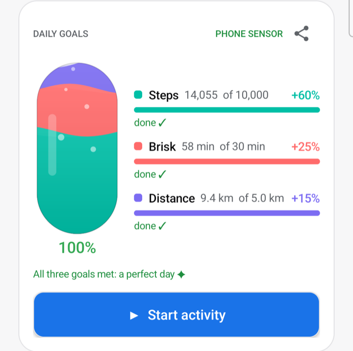
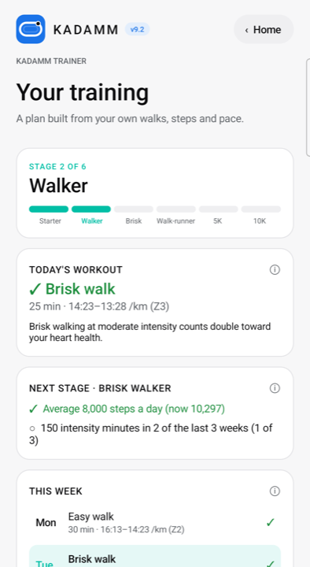
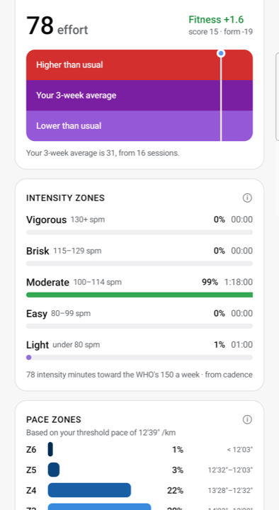
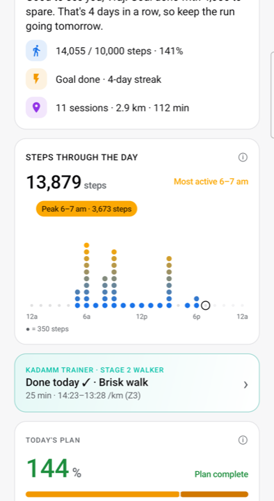
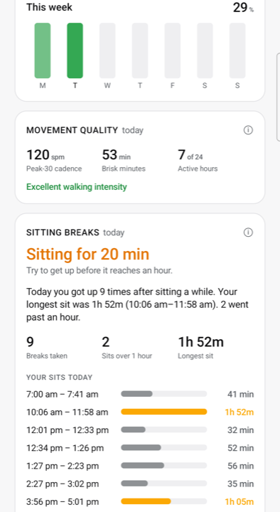
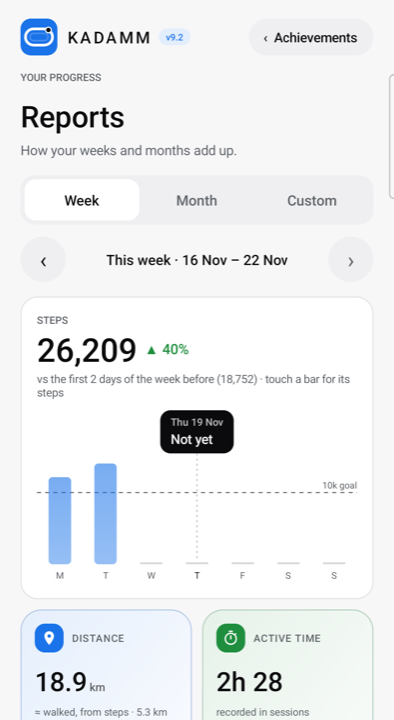
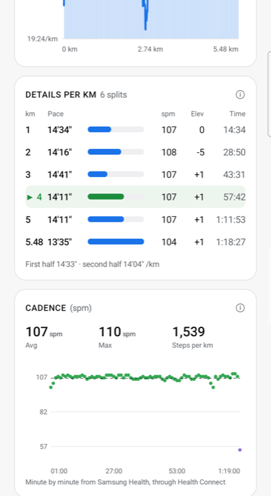
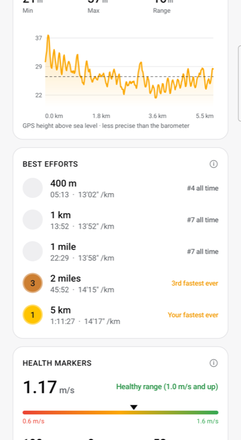
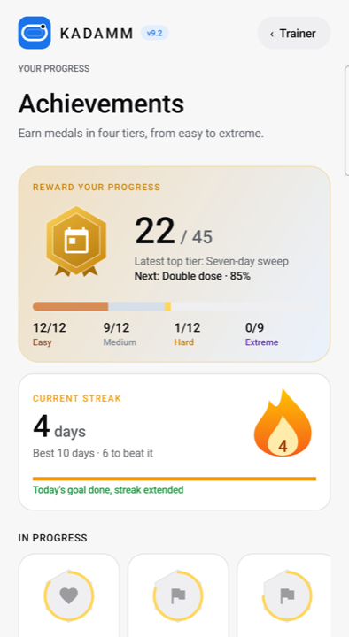

# Kadamm

**A walking and running tracker for Android that turns your steps into real insight.** No watch needed: Kadamm works from your phone's step counter, GPS and barometer, and adds heart rate automatically when a watch shares it through Health Connect.

[**⬇ Download the latest version**](https://github.com/vrajchauhan10/Kadamm/releases/latest) · Android 8.0+ · Updates itself from inside the app

  
  
  

## What it does

### Your day at a glance
- **Daily goals capsule:** steps, brisk minutes and distance fill one capsule in layers, each worth its share of the day; all three make a perfect day.
- **Steps through the day:** every hour as a column of dots, with your most active hour marked.
- **Movement quality:** peak-30 cadence, brisk minutes and active hours.
- **Sitting breaks:** how often you got up after sitting, your longest sit, and a gentle reminder after an hour still.

  
  
  

### Every walk, analysed
- **Smart sessions:** auto-detects walks, starts only after 100 steps, leaves out car rides, and recognises treadmill or indoor walking.
- **Relative effort, intensity zones and pace zones,** with WHO intensity minutes.
- **Details per km:** pace, cadence and climb for every kilometre.
- **Cadence and stride charts, grade-adjusted pace, and elevation from the barometer.**
- **Best efforts** from 400 m to half marathon, ranked against all your history.
- **Route replay** as a shareable video, and **day summaries** that add up all of a day's sessions.

  
  
  

### Training and progress
- **Coach Kadamm:** three new daily challenges, weekly challenges with trophies, a Sunday review, recovery days, streak protection, friend challenge codes, fitness age and a 4-week report.
- **Kadamm Trainer:** six stages from Starter to 10K runner, today's workout with pace targets, a weekly plan that adapts to your form, and a 4-week fitness forecast.
- **Reports:** weekly, monthly and custom ranges, with fitness and form, training load, a pace curve and a when-you-move heatmap.
- **45 badges** in four tiers, from easy to extreme, plus streaks and personal records.

### On your wrist (Wear OS)
- **Kadamm for Wear OS** works with any Wear OS 3+ watch (Galaxy Watch 4 and later, Pixel Watch, TicWatch, Fossil and others). It shows your steps ring, streak and today's challenges, and starts, pauses and finishes sessions from your wrist. Your watch's heart rate is saved with the session.
- **Every watch brand through Health Connect:** sleep stages, all-day heart rate, resting heart rate, HRV, breathing rate, blood oxygen, skin and body temperature, blood pressure, VO₂max and weight from Samsung Health, Fitbit, Garmin, Zepp, Withings, Oura and others.
- **Your body, measured:** Recovery (0–100 %), Strain (0–21) and Stress from your watch; Movement load, sleep estimates, sleep consistency, a Cooper 12-minute VO₂max test and a fingertip camera pulse check (heart rate and HRV) from the phone alone. Every measure says where it came from, and estimates are labelled.
- **Live:** with Kadamm open on the watch, heart rate reaches the phone every few seconds; all-day heart rate is sampled every 15 minutes.
- **Install on the watch:** turn on *Developer options › ADB debugging* and *Wireless debugging* on the watch, then on a computer run `adb connect <watch-ip>:<port>` and `adb install Kadamm-Wear-<version>.apk`. Keep Kadamm installed on the phone; the two pair automatically.

### Your data, your phone
- **Stays on your phone:** everything is stored on your phone, and accounts are local.
- **Health Connect is optional:** Kadamm can add steps and heart rate from Samsung Health, Zepp, Google Fit and others, and import months of past walks. Switch it off and Kadamm counts on its own.
- **No double counting:** step sources are never added together; Kadamm takes the most complete count.
- **Nothing made up:** when a sensor isn't available, Kadamm shows it as unavailable instead of guessing.

## Install and update

1. **Install:** download `Kadamm-<version>.apk` from the [latest release](https://github.com/vrajchauhan10/Kadamm/releases/latest) and open it, allowing installs from your browser when Android asks.
2. **Update:** from 9.2 on, Kadamm checks for new versions itself and offers **Update now**. Your sessions and settings stay.

## Build from source

`./build.sh` builds with the bundled toolchain in `tools/android-build` (JDK 17, Android SDK 35, Gradle 8.9) and writes `releases/kadamm-v<version>.apk`; `./build.sh install` also installs it on a USB-connected phone. `./release.sh` publishes the current version as a GitHub release. The application id stays `com.stride.run`, so updates keep installed data. See [CHANGELOG.md](CHANGELOG.md) for every version.

Map data © OpenStreetMap contributors. Crafted by V.
